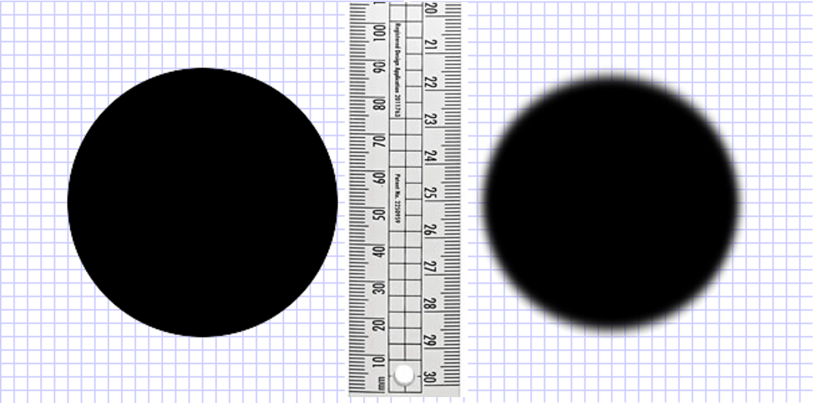
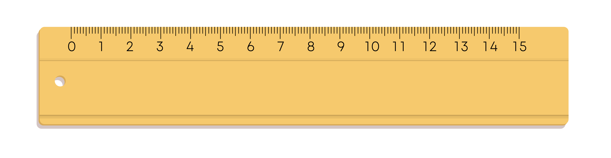

# Chapter 1: Units, Physical Quantities, and Vectors

## Table of Contents

- [1.1 The Nature of Physics](#11-The-Nature-of-Physics)
- [1.2 Solving Physics Problems](#12-Solving-Physics-Problems)
- [1.3 Standards and Units](#13-standards-and-units)
- [1.4 Using and Converting Units](#14-using-and-converting-units)
- [1.5 Uncertainty and Significant Figures: An Introduction to the Measurement Lab](#15-uncertainty-and-significant-figures-an-introduction-to-the-measurement-lab)

## 1.1 The Nature of Physics

### What is Physics?
- Physics is experimental
- This means you can put them into practice. If you get stuckl - try doing an exprerient at home.

### Semester Roadmap
 (Insert picture later)

## 1.2 Solving Physics Problems

### How to Solve Physics Problems "By the Book"

1. IDENTIFY the relevant concepts:
    - Use the physical conditions stated in the problem to help you decide which physics concepts are relevant.
    - Identify the *target variables* of the problems--that is, the quantities whose values you're trying to find, such as the speed at which a projectile hits the ground, the intensity of a sound made by a siren, or the size of an image made by a lens.
    - Identify the known quantities, as stated or implied in the problem. This step is essential whether the problem asks for an algebraic expression or a numerical answer.

1. SET UP the problem:
    - Given the concepts, known quantities, and target variables that you found in the IDENTIFY step, choose the equations that you'll use to solve th problem and decide how you'll use them. Study the worked examples in this book for tips on how to select the proper equations. If this seems challenmging, don't worry--you'll get better with practice!
    - Make sure that teh variables you have identified correlate exactly with those in the equations.
    - If appropriate,d raw a sketch of the situation described in the problem. (Graph paper and a ruler will help you make clear, useful sketches.)

1. EXECUTE the solution:
    - Here's where you'll "do the math" with the equations that you selected in the SET UP step to solve for the targhet variables that you found the IDENTIFY step. Study the worked examples to see what's involved in this step.

1. EVALUATE your answer:
    - Check your answer from the SOLVE step to see if it's reasonable. (If you're calculating how high a thrown baseball goes, an answer of $1.0\text{ mm}$ is unreasonably small and an answer of $100\text{ km}$) is unreasonably large.) If your answer includes an algebraic expression, confirm that it correctly represents what would happen if the variables in it had very large or very small values.
    - For future reference, make note of any answer that represents a quantity of particular significance. Ask yourself how you might answer a more general or more difficult version of the problem you have just solved.

### ...But It's More Complicated than That
- The most difficult parts happen _before_ those steps: reading the problem! An example problem from the book is below:

> **A Multistage Rocket.** In the first stage of a two-stage rocket, the rocket is fired from the launch pad starting from rest but with a constant acceleration of $3.50\text{ m}/\text{s}^2$ upward. At $25.0\text{ s}$ after launch, the second stage fires for $10.0\text{ s}$, which boosts the rocket's velocity to $132.5\text{ m}/\text{s}$ upward at $35.0\text{ s}$ after launch. This firing uses up all of the fuel. however, so after the second stage has finished firing, the only force acting on the rocket is gravity. Ignore air resistance.
>
>1. Find the maximum height that the stage-two rocket reaches above the launch pad. 
>1. How much time after the end of the stage-two firing will it take forthe rocket to fall back to the launch pad?
>1. How fast will the stage-two rocket be moving just as it reaches the launch pad?

- Be sure to practice visualizing and always draw a diagram if you can.
- As you read the problem, ask yourself: how do I feel?

## 1.3 Standards and Units

### SI Units
We'll be using SI units in this class. The following are the basic units in which we'll build other units:

| Quantity | Unit | Abbreviation |
| --- | --- | :---: |
| Time | seconds | s |
| Length | meter | m |
| Mass | kilogram | kg |

### Unit Prefixes
You should know your unit prefixes as well. Be sure to remember the ones in bold.

| Prefix | Number | Scientific Notation | Name |
| :---: | :---: | :---: | :---: |
| Exa (E) | 1,000,000,000,000,000,000 | $10^{18}$ | quintillion | 
| Peta (P) | 1,000,000,000,000,000 | $10^{15}$ | quadrillion |
| Tera (T) | 1,000,000,000,000 | $10^{12}$ | trillion |
| Giga (G) | 1,000,000,000 | $10^9$ | billion |
| Mega (M) | 1,000,000 | $10^6$ | million
| kilo (k) | 1,000 | $10^3$ | thousand |
| hecto (h) | 100 | $10^2$ | hundred |
| deca (da) | 10 | $10^1$ | ten |
|  | 1 | $10^0$ | one |
| deci (d) | 0.1 | $10^{-1}$ | one tenth |
| centi (c) | 0.01 | $10^{-2}$ | one hundredth |
| milli (m) | 0.001 | $10^{-3}$ | one thousandth |
| micro (μ) | 0.000001 | $10^{-6}$ | one millionth |
| nano (n) | 0.000000001 | $10^{-9}$ | one billionth |
| pico (p) | 0.000000000001 | $10^{-12}$ | one trillionth |
| femto (f) | 0.000000000000001 | $10^{-15}$ | one quadrillionth |
| atto (a) | 0.000000000000000001 | $10^{-18}$ | one quintillionth |

### British (Imperial) Units
Less common are British or Imperial units. we don't use them in physics often, but they come up all the time in engineering.

| Quantity | Unit | Abbreviation |
| --- | --- | :---: |
| Time | seconds | s |
| Length | foot | ft |
| ~~Mass~~ Force | pound | lb |

## 1.4 Using and Converting Units

- Before you start a problem make sure that all your units are consistent. Be sure you are familiar with how to convert units using dimensional analysis.
- Always report answers with units

## 1.5 Uncertainty and Significant Figures: An Introduction to the Measurement Lab

### Uncertainty in Direct Measurements
- There is a certain amount of error associated with any measurement or value you report.
- For example, when you're asked for the time, do you know the seconds or milliseconds associated with that? How sure are you?
- You need to report how _well_ you know an answer by reporting it.

### What are the sizes of the circles?

- One of the difficult parts about experimentation is _defining_ a measurement. The size of the blurry circle is dependent on how you define the term "circle." This is called a "problem of definition."
- It's important to have clear, reasonable definitions to avoid over- or underestimating a measurement.

### Uncertainty of a Measurement

Measurement error or uncertaininy is a combination of error that originates from you, the device you used to make the measurement, and random noise or chance. The scientific terms for these are:

- **Systematic Error.** This is an offset that leads to measurement bias. If you keep measuring it the same way you'll get the same answer. 
    - For example, [every measuring cup holds a slightly different amount of volume](https://food52.com/story/16497-the-truth-about-your-measuring-cup-dun-dun-dun). 
    - To minimize systematic error, you should verify your results by measuring it a different way when possible.
- **Random Error.** A repeated measurement will always vary in value due to noise or chance. 
    - For example, even when keeping the amount of yeast you use the same, your bread might be flatter or poofier, [depending on a lot of other environmental factors](https://www.kingarthurbaking.com/blog/2018/06/22/winter-to-summer-yeast-baking).
    - To minimize random error, you should take repeated measurements and take an average value.
- **Gross Error.** Human error due to lack of training, carelessness, etc.
    - For example, you may be inconsistent in measuring flour in a cup. Did you remember to [fluff, sprinkle, scrape?](https://www.kingarthurbaking.com/videos/baking-skills/how-to-measure-flour)
    - The best tactic is to make sure that you are properly trained on how to use a tool.

In the lab, we'll ignore gross error, because you are awesome, and you never make mistakes. You'll have to consider which of the first two types of errors contribute _most_ to your measurement error; this is the how you will decide on what to report for error/uncertainty.

### When Systematic Error is the Greatest

#### Accuracy and Precision
- _Accuracy_ and _precision_ are two qualities that are intrinsic to the measurement tool.
    - Accuracy: How close are you to the true value? 
    - Precise: How repeatable are the measurements?
- Below is am image that hopefully helps you understand the relationship between accuracy and precision.

![The image shows four archery targets, each made up of concentric rings. The top-left target is labelled as "accurate" and "precise." This target has X markings grouped closely together near the center, or the "bullseye." The top right is labelled as "accurate" and "not precise." In this one, the X markings are scattered, but centered around the bullseye. The bottom left target is labelled as "not accurate" and "precise." The X markings are grouped very closely together, however they sit far to the left of the bullseye. Finally, the last target is "not accurate" and "not precise." The X markings are scattered and not centered around the bullseye.](/ch-01/accuracy-and-precision.png)

- For the sake of our class, we assume that all our measurement tools are accurate when used correctly. This means that the error you report will then be related to the _precision_ of the tool. 

#### Precision, Significant Figures, and Reporting Error/Uncertainty
- The more precise the tool, the smaller increment of measurement (in other words, the more numbers to the right of the decimal point, when applicable). 
- When we report a measurement, usually the _last_ digit we report is the one that we guess.

- The smallest increment of the ruler shown in the image is 1 millimeter. That means that you might report as measurement as

$l = 86.2 \text{ mm}$

- The last digit, in this case $.2$, is the digit you would have guessed.

- To report error, we take the smallest increment and divide it in half. In our example, that would be $(1 \text{ mm})/2=0.5 \text{ mm}$. Our measurement would then be reported as:

$l \pm \delta l = 86.2 \pm 0.5 \text{ mm}$ 

- In this case, $l$ is our measurement, and $\delta l$ is the measurement error or uncertainty.

- Be sure you know how to handle significant figures when mathematically manipulating your measurements.

#### Percent Error
- In contrast, a measurement with a greater number of significant figures typically has a _lower_ percent error.

- Take the rulers below, which have different levels of precision.

- Following our rule of reporting measurements, the red line marks the following locations on the three rulers:
    - Top ruler: $l \pm \delta l = 0.5 \pm 0.5 \text{ dm}$
    - Middle ruler: $l \pm \delta l = 5.8 \pm 0.5 \text{ cm} = 0.58 \pm 0.05 \text{ dm}$
    - Bottom ruler: $l \pm \delta l = 57.4 \pm 0.5 \text{ mm} = 5.73 \pm 0.05 \text{ cm} = 0.573 \pm 0.005 \text{ dm}$
- Note that the ruler wtih the smallest increment resulted in the greatest number of significant figures, and thus the smallest percent error.

### When Random Error is the Greatest

#### Repeating Measurements
- If a measurement is repeatable, you should repeat it! This eliminates human error and reduces noise.
- Presumably, your measurement will be centered around a trule value (which we assign as the average value). The distribution you get as you obtain more values becomes a "nomral" or a "Gaussian" distribution.

#### Gaussian Distribution
- If you were to plot your measurements as a histogram, you would start seeing a Gaussian distribution, which is a bell curve.
- The more measurements you make, the less wide the distribution becomes, and the more sure of your answer you are.
- We describe this width using the standard deviation ($\sigma$). The range of the values that are one standard deviation above and below the average value represents 67% of the entire population.
- We can also use the standard deviation to report our measurement error/uncertainy:

$\text{Measurement}=x_\text{Avg} \pm \sigma$

#### Caculating Standard Deviation

There are two types of standard deviation. When calculating it, be sure you know which one you're using:
- Sample: Used when you only have a small sample but you're trying to generalize it to a larger population.

$\sigma_s=\sqrt{\frac{\sum_{i} (x_i-\overline{x})}{N-1}}$

- Population: You have the entire population of samples that you care about, and you're _not_ trying to generalize it to a larger population.

$\sigma_p=\sqrt{\frac{\sum_{i} (x_i-\overline{x})}{N}}$

- In both cases, $\overline{x}$ is the average, and $N$ is the number of samples.

#### Reporting Measurement Error/Uncertainty When You Have Random Error

- For this class, you want to take at least **five** measurements and you want to use the **population standard deviation**.

- Let's say your measurements were $7.2 \text{ s}$, $8.5\text{ s}$, $7.8\text{ s}$, $8.1 \text{ s}$, and $7.5\text{ s}$. You'll want to start by calculating the average:

$t_\text{Avg}= \frac{7.2+8.5+7.8+8.1+7.5}{5}=7.82 \text{ s}$

- Then you can use that to calculating the standard deviation.

$\sigma_p=\sqrt{\frac{(7.2-7.82)^2+(8.5-7.82)^2+(7.8-7.82)^2+(8.1-7.82)^2+(7.5-7.82)^2}{5}}=0.453 \text{ s}$

- Now you can report your value. Typically, you can round your standard deviation to a single digit, and then make sure that your average is rounded to the _same_ digit.

$t=7.8 \pm 0.5 \text{ s}$

### Dependent Measurement Error

#### Dependent Measurements
- Most values can't be measured directly -- they are actually calculated from other measurements. For example, we can't measure area directly. It must be calculated by multiplying base with height.
- This means that our error in the calculated value must be calculated from the error of our original measurements.

#### Arbitraty Functions of One Variable
Let's say you have some function $q(x)$. When you make a measurement of $x$, you'll report your measurement as:

$x=x_\text{best} \pm \delta x$

where $x_\text{best}$ is your best guess (average), and $\delta x$ is your measuyrement error. How much error would we have in $q(x)$?

If we plug in $x$ into the equation, we get

$q_\text{best}=q(x_\text{best})$

$\delta q=q(x_\text{best}+\delta x)-q(x_\text{best})$

We can take the equation for $\delta q$ and divide both sides by $\delta x$.

$\frac{\delta q}{\delta x}=\frac{q(x_\text{best}+\delta x)-q(x_\text{best})}{\delta x}$

We can assume that you used a really good measurement tool so that your error $\delta x$ is really small compared to $x$. We can take $\delta x \to 0$.

$\frac{\delta q}{\delta x}=  \lim_{x \to 0}\frac{q(x_\text{best}+\delta x)-q(x_\text{best})}{\delta x}$

We can compare this to the definition of the derivative:

$f'(a)=\lim_{h \to 0} \frac{f(a+h)-f(a)}{h}$

We can then say that

$\frac{\delta q}{\delta x} = \frac{dq}{dx}$

Finally, we can say that the error $\delta q$ is

$\delta q = \pm \frac{dq}{dx} \delta x$

For functions with multipled variables, the error is given as:

$\delta q^2 = (\frac{\partial q}{\partial x}\delta x)^2 + (\frac{\partial q}{\partial y}\delta y)^2 +...(\frac{\partial q}{\partial z}\delta z)^2$

